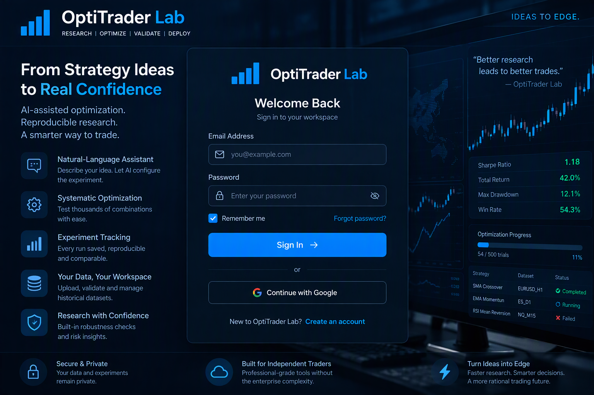
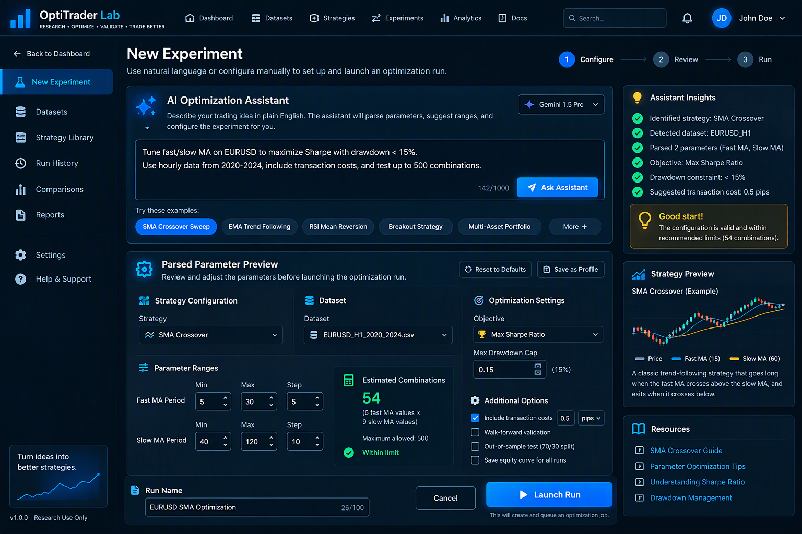
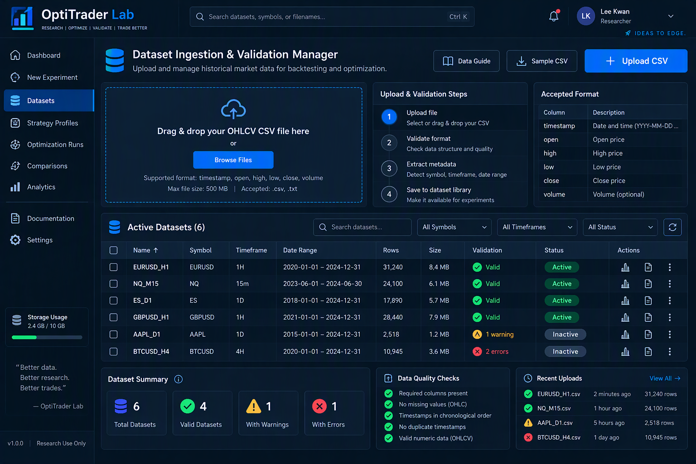
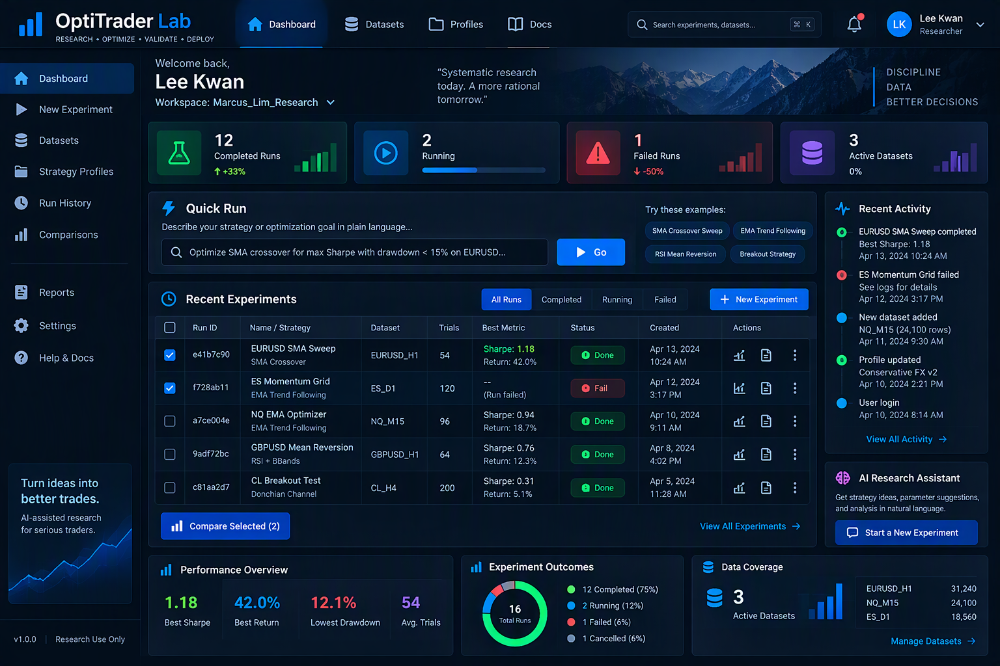
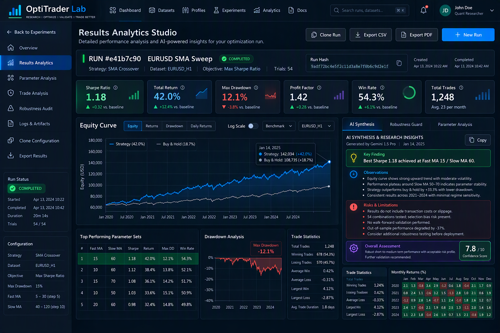
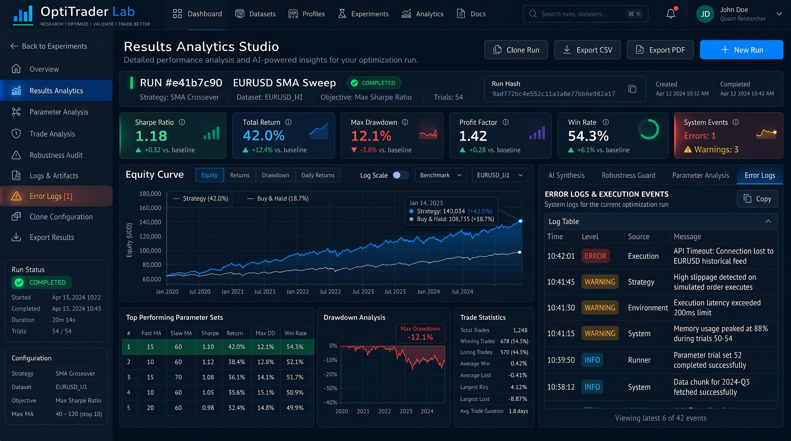
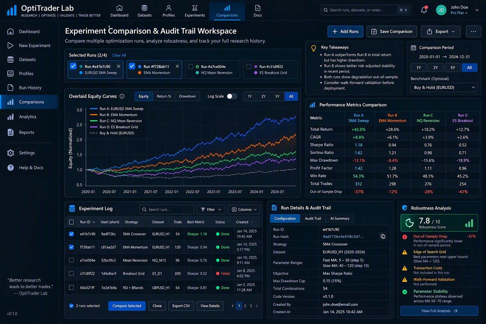

# OptiTrader Lab

## Capstone Project Proposal & Design Documentation

**BELLS SCTP Diploma in AI-Powered Software Engineering**  
**Module 9 Capstone Project**

**Author:** Lee Kwan  
**Version:** 3.1 (Enhanced Technical Specification Edition)  
**Date:** 25 October 2026

---

# Executive Summary

OptiTrader Lab is an AI-assisted optimization platform designed for solo quantitative traders and systematic strategy developers.

The project addresses the inefficiencies of manual strategy optimization, including repetitive parameter tuning, fragmented result storage, configuration drift, and limited experiment traceability.

The proposed solution combines:

- Natural-language optimization workflows
- Historical dataset management
- Automated optimization execution
- Experiment tracking and auditability
- AI-generated analytics and summaries
- Robustness validation tools

> **Design Principle:** Every optimization is treated as a reproducible experiment.

The system enables traders to focus on strategy research rather than manual experiment management.

---

# Table of Contents

1. Project Overview
2. User Research & Problem Definition
3. Solution Design
4. Feature Specifications
5. MVP Scope
6. User Stories & Acceptance Criteria
7. User Journey
8. Prototype Design
9. System Architecture & Technical Design
10. AI Integration & Safety
11. Data Schema & Persistence Layer
12. Security & Validation
13. Testing & Deployment Strategy
14. Success Criteria
15. Future Scope
16. Conclusion

---

# 1. Project Overview

## 1.1 Project Details

| Item | Detail |
|--------|--------|
| Project Name | OptiTrader Lab |
| Tagline | A lightweight, AI-assisted web portal that turns strategy tuning into tracked and repeatable experiments |
| Audience | Solo traders and quantitative developers |
| Primary Problem | Manual parameter tuning and fragmented research workflows |
| Core Innovation | AI-guided optimization backed by reproducible experiment tracking |
| AI Technology | Google Gemini Function Calling |
| Persistence Layer | Experiment Log and Audit Trail |
| Stack | React, Node.js/Express (ES6 modules), MongoDB, Gemini API, Python 3.11/vectorbt |

---

## 1.2 Learning Outcome Mapping

| Learning Outcome | Evidence |
|------------------|----------|
| LO1 | Persona, pain points, problem statement |
| LO2 | Ideation, MoSCoW, user stories |
| LO3 | Wireframes and prototypes |
| LO4 | Data structures, validation, and database schemas |
| LO5 | Documentation, architecture, and deployment strategy |
| LO6 | Gemini function calling, AI integration, and output validation |

---

## 1.3 Implementation status (PoC)

| Area | Status |
|---|---|
| React client | Implemented with mock-data mode and live-API mode |
| Express API | Implemented: JWT auth, dataset/profile/run CRUD, assistant, comparison |
| MongoDB | Implemented with Mongoose models, owner-scoped queries and seed script |
| Python engine | Implemented with `vectorbt`; SMA crossover path is active |
| Gemini assistant | Function calling with local heuristic fallback |
| Tests | Node config/domain tests, JS ↔ Python bridge tests, pytest engine tests |
| Post-MVP | Redis queue, S3 storage, WebSocket progress, EMA-specific engine, walk-forward validation |

---

# 2. User Research & Problem Definition

## Target Audience

The primary audience consists of:

- Solo algorithmic traders
- Independent quantitative researchers
- Systematic futures traders
- Forex strategy developers
- Python-based backtesting enthusiasts

Characteristics:

- Comfortable writing Python
- Not professional software engineers
- Frequently use spreadsheets for analysis
- Need optimization tools without enterprise complexity

---

## User Persona

### Marcus Lim

| Attribute | Description |
|--------|--------|
| Age | 31 |
| Occupation | Full-Time Systematic Trader |
| Background | Former Bank Risk Analyst |
| Tools | Python, Pandas, Jupyter, Excel |
| Goal | Improve strategy quality while reducing manual effort |
| Frustration | Repetitive optimization cycles and poor experiment traceability |

---

## Pain Points

### P1 – Repetitive Optimization Workflow
Users repeatedly edit Python constants, execute scripts, rename files, and copy metrics.

### P2 – Fragmented Result Storage
Optimization outputs become scattered across CSV files, Excel sheets, and Notebook outputs.

### P3 – Low Confidence in Results
Users often cannot answer: *How many tests were performed? Was the winner genuinely robust? Has the strategy been validated?*

### P4 – Configuration Drift
Changes to parameters, date ranges, and commission settings often occur without proper tracking.

### P5 – Existing Solutions Are Poorly Positioned
Most alternatives are too heavy, too expensive, too technical, or too restrictive.

---

## Root Cause

There is no lightweight platform that:
- Separates parameters from strategy code
- Tracks optimization runs
- Stores complete experiment history
- Provides reproducible audit records

---

# 3. Solution Design

## Product Vision

```text
Strategy Idea
      ↓
Natural Language Prompt
      ↓
Configuration Generation
      ↓
Optimization Execution
      ↓
Experiment Tracking
      ↓
AI Analysis
      ↓
Decision Making
```

---

## Core Design Principle

### Every Optimization Is An Experiment

Each optimization run becomes a permanent experiment record.

Every experiment stores:

```text
Run ID
Run Hash
Strategy
Configuration
Dataset
Date Range
Trial Count
Timestamp
Results
Warnings
AI Summary
```

This solves result fragmentation, experiment traceability, overfitting uncertainty, and reproducibility concerns.

---

# 4. Feature Specifications

## F1 – Strategy Config Manager
Manage parameter profiles separately from code. Supports Create, Edit, Clone, and Version Profiles.

## F2 – Historical Data Manager
Provide validated historical datasets. Supports CSV Upload, Validation, Metadata Extraction, and Dataset Cataloging.

## F3 – Optimization Run Engine
Automate parameter sweeps. Supports Grid Search, Queue Management, Progress Tracking, Background Execution, and **Job Cancellation**.

## F4 – Experiment Log & Trial Counter
Maintain permanent experiment history. Stores Run ID, Run Hash, Configuration Snapshot, Dataset, Date Range, Trial Count, Timestamp, Metrics, AI Summary, and Status.

## F5 – Results Analytics Dashboard
Provides Equity Curves, Metrics, Comparison Tables, Export Functions, and **Error Logs for Failed Runs**.

## F6 – Natural Language Optimization Assistant
Powered by Gemini Function Calling. Parses intent, builds configuration, validates constraints, and launches optimization.

## F7 – Robustness Guard
Risk-awareness framework. Checks: Out-of-sample degradation, Edge-of-grid solutions, Missing transaction costs, Walk-forward validation status, and Small sample size.

## F8 – Authentication & Personal Workspace
Provides Registration, Login, JWT Authentication, and Private User Workspaces.

---

# 5. MVP Scope

The MVP includes:
- Authentication
- Dataset Management
- Parameter Profiles
- Optimization Execution
- Experiment Log
- Results Dashboard
- Gemini Assistant

**Built-in Strategies:** SMA Crossover, EMA Momentum
**Supported Datasets:** OHLCV CSV Files
**Optimization Objectives:** Sharpe Ratio, Total Return, Calmar Ratio

---

# 6. User Stories & Acceptance Criteria

*(Refer to previous version for US1-US5)*

## US6 – Natural Language Assistant
As a trader, I want to describe goals in English instead of configuring everything manually. 
*Acceptance Criteria:* System must validate AI-generated JSON against strict backend schemas before execution.

## US7 – Personal Workspace
As a user, I want my work stored privately.

## US8 – Robustness Guard
As a trader, I want warnings when results appear overfitted.

### US9 – Job Cancellation & Error Handling
As a trader, I want to cancel a long-running optimization job and view detailed logs if a run fails.

---

# 7. User Journey

```text
Login
   ↓
Upload Dataset
   ↓
Create Profile
   ↓
Describe Goal
   ↓
Launch Optimization
   ↓
Review Analytics (Cancel if needed)
   ↓
Compare Experiments
   ↓
Clone Best Run
```

---

# 8. Prototype Design

## Screen 0 – Login & Personal Workspace

Supports authentication and private user workspaces.



### Key Features

- Login
- Registration
- Workspace Ownership

---

## Screen 1 – Dashboard & Active Workspace



### Purpose

Provides optimization overview and quick experiment launch.

### Key Components

- Workspace Context
- Quick Run Assistant
- Recent Experiments
- Activity Feed
- Trial Counters

---

## Screen 2 – Natural Language Assistant & Configuration Studio



### Purpose

Convert plain-English requests into optimization jobs.

### Key Components

- Prompt Input
- Strategy Selection
- Parameter Range Controls
- Combination Counter
- Launch Controls

---

## Screen 3 – Dataset Ingestion & Validation Manager



### Purpose

Manage historical datasets and perform automated validation.

### Features

- CSV Upload
- Validation Checks
- Metadata Catalog
- Dataset Library

---

## Screen 4 – Results Analytics Studio/ Error Log Console

### 4.1 Results Analytics Studio



#### Key Metrics

- Sharpe Ratio
- Profit Factor
- Total Return
- Max Drawdown
- Trial Count

#### Experiment Identity

```text
Run ID
Run Hash
Timestamp
```

#### AI Synthesis

Provides:

- Key Findings
- Optimization Commentary
- Risk Indicators

#### Robustness Guard

```text
⚠ Out-of-Sample Degradation

⚠ Missing Transaction Costs

⚠ Missing Walk-Forward Validation

⚠ Edge of Search Grid
```

### 4.2 Error Log Console


************************

Error Logs Panel Design

```
Use a warning/error icon:

<i class="bi bi-exclamation-octagon"></i>

Error Logs View
┌─────────────────────────────────────────────────────────────┐
│ ERROR LOGS & EXECUTION EVENTS                               │
├─────────────────────────────────────────────────────────────┤
│ Severity │ Timestamp           │ Component │ Message        │
├─────────────────────────────────────────────────────────────┤
│ Warning  │ 2026-10-20 10:34:01 │ Backtest  │ Commission not │
│          │                     │ Engine    │ specified      │
├─────────────────────────────────────────────────────────────┤
│ Warning  │ 2026-10-20 10:34:05 │ Validator │ Holdout size   │
│          │                     │           │ below 25%      │
├─────────────────────────────────────────────────────────────┤
│ Info     │ 2026-10-20 10:34:08 │ Optimizer │ 54 trials      │
│          │                     │           │ queued         │
├─────────────────────────────────────────────────────────────┤
│ Info     │ 2026-10-20 10:34:22 │ Optimizer │ Best Sharpe    │
│          │                     │           │ updated: 1.18  │
└─────────────────────────────────────────────────────────────┘

Failed Run Support

For failed runs:

Run Status: FAILED

Error Code:
TIMEOUT

Message:
Optimization exceeded 120 second execution limit.

Suggested Action:
Reduce search space or lower combinations.


Using your sample data:

{
  "status": "failed",
  "error_code": "TIMEOUT",
  "trials": 120
}


The Error Logs tab can automatically show:

ERROR SUMMARY

Code:
TIMEOUT

Details:
Optimization exceeded execution timeout.

Trials Requested:
120

Maximum Allowed:
120 Seconds

Recommended Fix:
Reduce parameter ranges.

Add Error & Warning Counters

Under KPI cards:

Warnings        Errors
3               1


or:

Warnings: 3
Errors: 0


For completed run:

Warnings: 3
Errors: 0


For failed run:

Warnings: 1
Errors: 1

JSON Extension Recommendation

Extend mockData.json:

"error_logs": [
  {
    "severity": "warning",
    "timestamp": "2026-10-20T10:34:01Z",
    "component": "Backtest Engine",
    "message": "Commission not specified."
  },
  {
    "severity": "warning",
    "timestamp": "2026-10-20T10:34:05Z",
    "component": "Validator",
    "message": "Holdout size below recommended threshold."
  },
  {
    "severity": "info",
    "timestamp": "2026-10-20T10:34:22Z",
    "component": "Optimizer",
    "message": "Best Sharpe updated to 1.18."
  }
]

UX Improvement

Add a notification badge:

Logs & Artifacts      [3]
Error Logs            [1]


where:

Blue badge = informational events
Yellow badge = warnings
Red badge = errors
Capstone Value

Adding Error Logs strengthens:

Feature	BenefitF4 Experiment Log	Complete experiment history
F5 Results Dashboard	Deeper diagnostics
F7 Robustness Guard	Validation visibility
Trust & Auditability	Stronger justification for deployment decisions
LU6	Better software engineering practices
```

---

## Screen 5 – Experiment Comparison & Audit Trail Workspace


### Comparison Layer

- Equity Curve Overlay
- Metrics Comparison Matrix
- Out-of-Sample Analysis

### Experiment Log

```text
Run ID
Run Hash
Dataset
Trials
Status
Timestamp
```

### Audit Trail

Supports:

- Reproducibility
- Version Tracking
- Run Cloning
- Historical Validation

---

## High-Fidelity Prototype Evolution

The polished PNG mockups are enhanced visual interpretations of the original low-fidelity wireframes.

Enhancements include:

- Institutional-grade dashboard styling
- KPI cards
- Enhanced charting
- AI audit summaries
- Robustness panels
- Risk indicators
- Experiment log visualization

These enhancements improve usability while preserving the MVP workflows, feature definitions, and acceptance criteria.

---

# 9. System Architecture & Technical Design

## 9.1 Architecture Diagram

```text
┌────────────────────────────┐
│       React Frontend       │ (Vercel/Netlify/Render)
└────────────────────────────┘
              │
              ▼ REST API + JWT
┌────────────────────────────┐
│   Node.js (ES6) / Express   │ (Render/Railway)
└────────────────────────────┘
       │          │                 │
       ▼          ▼                 ▼
   MongoDB    Gemini API     Worker Process
   (Atlas)    (AI Config)    (Node child_process)
                                    │
                                    ▼
                          Python 3.11 / vectorbt
                                    │
                                    ▼
                          Experiment Log (MongoDB)
```

> Redis queues, S3 storage and WebSocket progress streaming are post-MVP; the PoC uses local uploads and synchronous child-process execution.

## 9.2 Execution & Progress Tracking
The PoC uses a Python child-process bridge for backtesting because `vectorbt`/pandas provide the required metrics and are fast enough for the MVP. The Node.js orchestrator is written with ES6 modules (`import`/`export`, `"type": "module"`), spawns Python with `PYTHONUNBUFFERED=1`, enforces a 120-second timeout, and parses a JSON result from stdout. The current HTTP request waits for the run to finish; Redis queues, polling progress and WebSocket streaming are post-MVP.

## 9.3 Reproducibility & Run Hash
To support reproducibility, the **Run Hash** is generated using a SHA-256 hash of the following concatenated string:
`SHA256(Strategy_ID + JSON.stringify(Sanitized_Config) + Dataset_Checksum + Engine_Version)`
This ensures that if a user runs the exact same hash, the exact same results will occur.

---

# 10. AI Integration & Safety

## 10.1 Gemini Function Calling
Supported Functions:
```text
create_configuration()
validate_dataset()
launch_optimization()
summarize_results()
compare_runs()
```

## 10.2 AI Safety & Prompt Injection
LLMs can hallucinate parameters or be subjected to prompt injection. 
- **Schema Validation:** The backend does **not** blindly trust the JSON generated by Gemini. The JSON must pass strict validation using **Zod** (a TypeScript-first schema declaration and validation library).
- **Parameter Clamping:** If the AI suggests a Fast MA of `-5` or a Max Drawdown of `200%`, the backend validation will reject the payload and return a user-friendly error to the UI.
- **API Fallback:** If the Gemini API times out or fails, the UI will fall back gracefully, allowing the user to configure the run manually.

---

# 11. Data Schema & Persistence Layer

## 11.1 File Storage vs. Database
- **Datasets (CSVs):** The PoC writes uploaded CSV files to `server/uploads/` and stores the path in MongoDB. Raw files are **not** stored inside MongoDB documents. An S3 bucket is a post-MVP option for deployment.
- **MongoDB:** Stores the *metadata* (filename, rows, validation status, file reference) and the *optimization results*.

## 11.2 Core MongoDB Collections
1. **Users:** `{ id, name, email, passwordHash, workspaceName }`
2. **Workspaces:** `{ id, user, name, owner }`
3. **Datasets:** `{ id, owner, name, symbol, timeframe, date_range, rows, file_ref, status }`
4. **Profiles:** `{ id, owner, name, strategy_type, objective, max_drawdown_limit, params }`
5. **Runs:** `{ id, owner, profile_id, dataset_id, run_hash, config, status, trials, best, robustness, equity_curve, ai_summary, error_code }`
6. **ErrorLogs:** `{ owner, experiment_id, severity, timestamp, component, message }`
7. **Settings:** `{ key, value }`

Trial-level logging is a post-MVP addition; the PoC stores the best result and equity curve on each run.

---

# 12. Security & Validation

- **Password Security:** Passwords are hashed with **bcrypt** (12 salt rounds) before database insertion.
- **Data Isolation (IDOR Prevention):** All API endpoints fetching datasets, runs, or profiles apply an owner-scoped query using the user ID from the JWT.
- **Rate Limiting:** `express-rate-limit` protects the Gemini assistant endpoint; login and queue protection can be extended post-MVP.

---

# 13. Testing & Deployment Strategy

## 13.1 Testing Strategy
- **Engine unit tests (pytest):** Focus on the mathematical correctness of the backtesting engine (e.g., argument parsing, CSV validation, SMA crossovers, drawdown-cap filtering, and Sharpe/return selection).
- **Config-validation tests (Node `node:test`):** Validate required environment variables (`MONGO_URI`, `GEMINI_API_KEY`, `CLIENT_URL`, `PORT`) without touching MongoDB or the Gemini network. `npm run config:check` runs the same validation against a real `.env`.
- **Domain tests (Node `node:test`):** Cover combination counting, CSV parsing, run hashes, assistant fallback parsing and Zod schemas.
- **Bridge tests (Node `node:test`):** Spawn the real Python engine against a committed OHLCV fixture, then assert successful JSON parsing, missing-file errors, invalid-config errors, and timeout enforcement. No MongoDB or Gemini key is required.
- **Integration tests (planned, Supertest):** API endpoints with a test MongoDB, specifically authentication, owner scoping, CORS origin handling and AI schema validation.
- **UAT (User Acceptance Testing):** Manually test the robustness guard logic by intentionally feeding it an overfitted configuration and follow the README troubleshooting section for CORS, MongoDB/WSL, Python-version and API-key failures.

## 13.2 Deployment Strategy
- **Frontend:** Vercel (seamless React deployment).
- **Backend API & Worker:** Render or Railway (supports Node.js background workers).
- **Database:** MongoDB Atlas (Cloud database).
- **CI/CD:** GitHub Actions to run tests on push to `main` before deployment.

---

# 14. Success Criteria

The capstone is considered successful if users can:
- ✅ Upload market data and have it strictly validated.
- ✅ Create optimization profiles.
- ✅ Launch parameter sweeps and review the resulting metrics and equity curves.
- ✅ Track experiment history and reproduce results using the Run Hash.
- ✅ Compare multiple runs.
- ✅ Understand robustness risks and view AI-generated analysis.
- ✅ Operate without editing source code.

---

# 15. Future Scope (Out of MVP Bounds)

To manage scope effectively, the following features are explicitly excluded from the MVP:
- Live broker integration (e.g., Interactive Brokers, MetaTrader).
- User-written custom Python strategy uploads.
- Walk-forward optimization engine (MVP will only flag it as missing).
- Machine Learning based strategy generation.

---

# 16. Conclusion

OptiTrader Lab transforms optimization from a manual, error-prone workflow into a structured, auditable experimentation process. 

By combining natural-language interaction, experiment tracking, reproducibility controls, and AI-assisted analytics, the platform directly addresses the root causes identified during user research while remaining lightweight enough for solo quantitative traders.

The defining innovation is not simply automation. It is the introduction of an experiment-centric workflow where every optimization is traceable, reproducible, comparable, and explainable. This creates greater confidence in research outcomes and helps traders spend less time managing files and more time evaluating ideas.